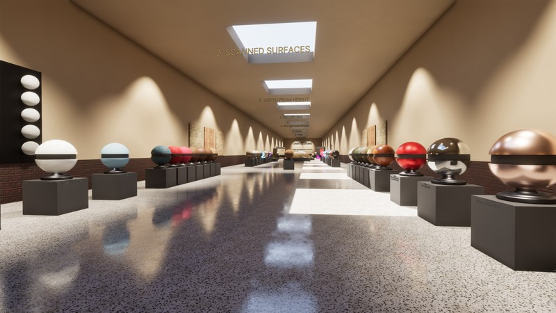
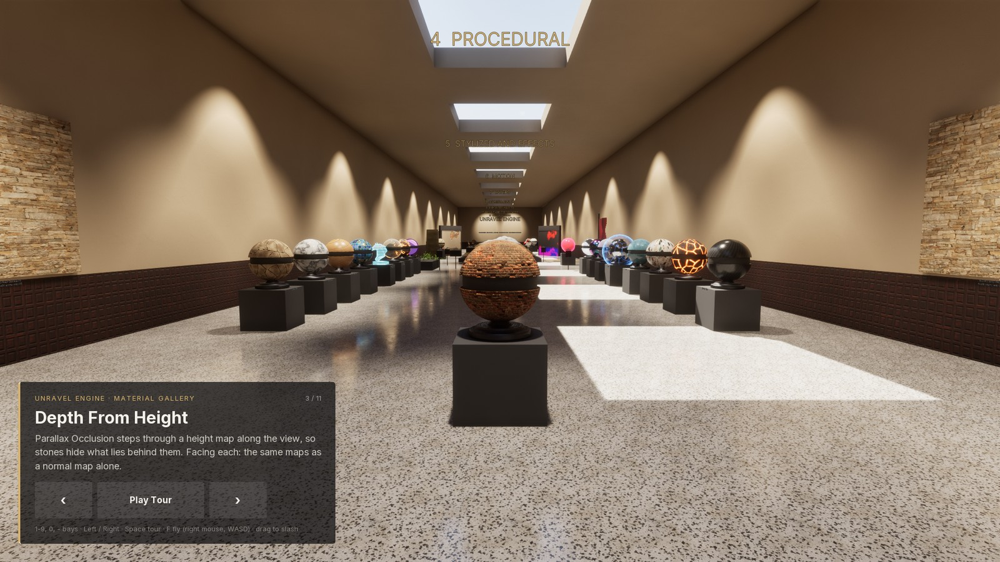
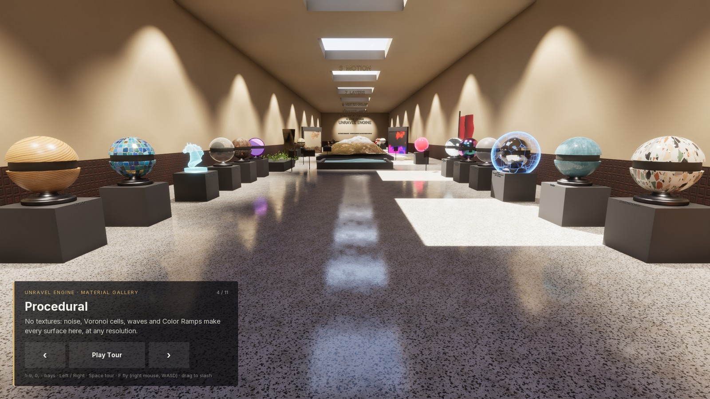
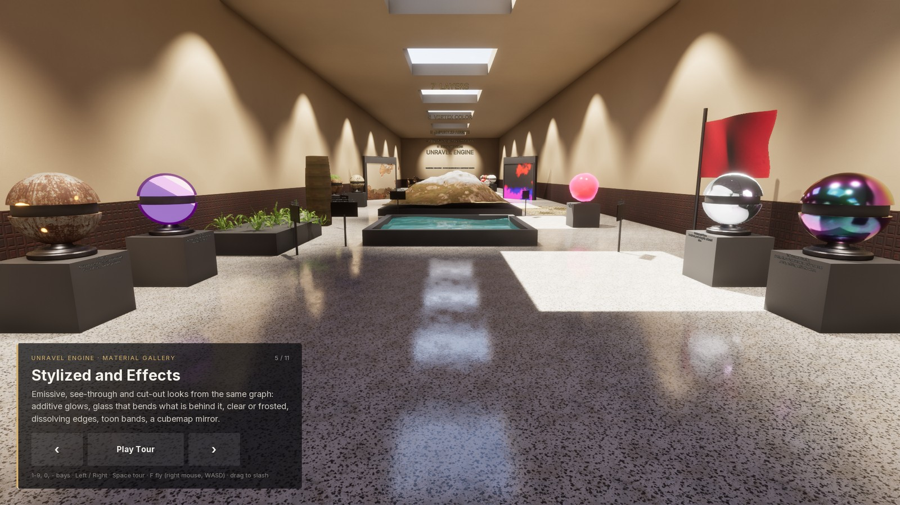
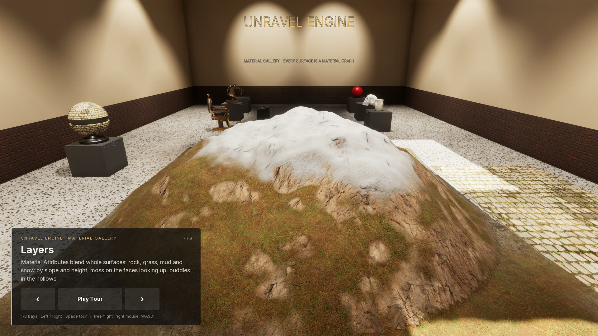
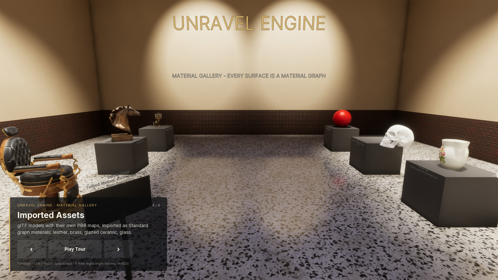
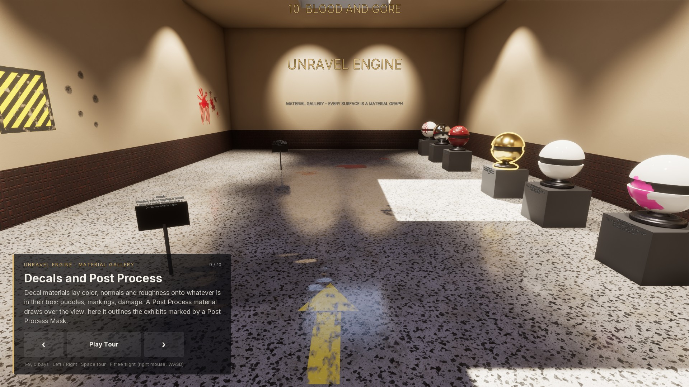
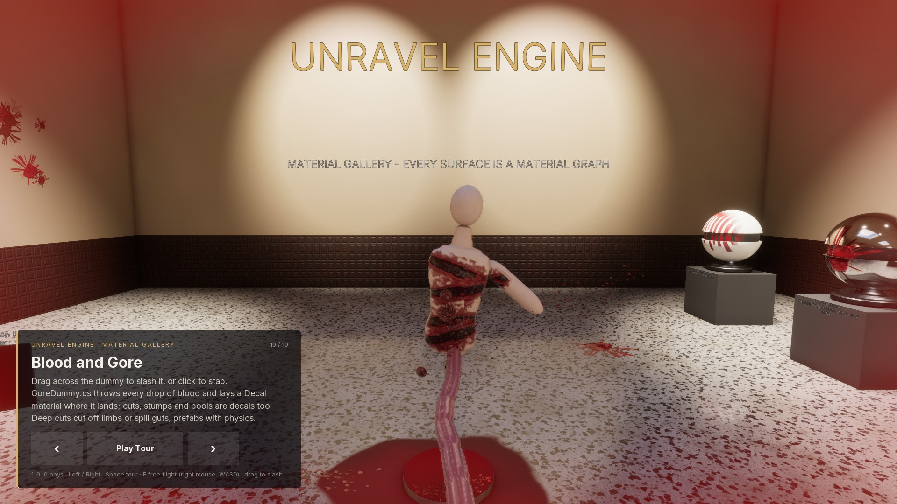

# Material Gallery

A gallery hall of ten bays that walks through what the engine's material graphs can do, from measured metals to
procedural lava. Every surface in the hall, the floor and walls included, is a material graph: open any `.mat` in
the Material Graph window (double-click it in the Content Browser) to see how it is built, change a value and watch
the scene follow. A sample project for [Unravel Engine](https://github.com/unravel-dev/UnravelEngine).

## Play

Clone this repository, or get it from the Samples page of the Unravel editor's start page, and open its folder in
the editor. Open `data/Scenes/Gallery.spfb` and press Play.

| Action | Keyboard and mouse | Gamepad | Touch |
|---|---|---|---|
| Go to a bay | 1 - 9, and 0 for the tenth | - | - |
| The bay before or after | Left / Right | - | The HUD's arrows |
| Start or stop the tour | Space | - | Play Tour button |
| Free flight | F; hold the right mouse button to look, WASD to move, Q / E down and up, Shift to hurry, the wheel for speed | - | - |
| Slash the dummy (bay 10) | Drag the left mouse button across it, faster for a deeper cut; a click stabs | - | Drag a finger across it |

## What it shows

1. **Physically Based.** Metals and dielectrics from the Standard graph with measured values. A 5 x 5 chart of
   metallic against roughness: one material, each sphere an instance that overrides Metallic and Roughness.
2. **Scanned Surfaces.** Photographed texture sets with packed occlusion, roughness and metallic maps, a detail
   normal blended with Blend Normals, and triplanar projection without UVs.
3. **Depth From Height.** Parallax Occlusion against the same maps as normal maps alone, and a single Bump Offset.
4. **Procedural.** Cracked earth, marble, wood, mosaic, carbon fibre, lava and terrazzo from noise, Voronoi cells,
   waves and Color Ramps, with no textures. Caustics: pool tiles under the light the water's ripples focus, traced
   back through the surface in a Custom node, each colour falling a little apart.
5. **Stylized and Effects.** An additive, unlit hologram; a force field on an Order Independent shell, whose faces
   blend without sorting; clear glass that bends the core behind it (Refraction) and frosted glass that blurs it by its
   Roughness; dissolve, iridescent coating, toon shading and a cubemap mirror.
6. **Motion.** World Position Offset: ferns in the wind around their own pivots with a phase per copy (Object
   Position, Per Instance Random), a waving banner, see-through water that bends the pool floor (Refraction) and
   clears where it is shallow (Depth Fade), its ripples the ones whose light the floor's caustics show, a twisting column and a breathing blob. A Vertex
   Interpolator carries the banner's shading from its vertices to its pixels.
7. **Layers.** Material Attributes blend whole surfaces: a terrain of rock, grass, mud and snow by slope and height,
   moss on a boulder, puddles on cobblestones.
8. **Imported Assets.** glTF models with their own maps, imported as Standard graph materials.
9. **Decals and Post Process.** Decal materials lay color, normals and roughness onto the surfaces in their box:
   puddles that darken and gloss the floor they read, a worn floor marking, a hazard sign and bullet damage on the
   wall, a paint splat bending around a ball beside one whose Receive Decals is off. A Post Process material on the
   bay's own volume outlines the gold ball, marked by its Post Process Mask, and fades in as you enter.
10. **Blood and Gore.** A training dummy to cut up. Drag across it to slash along the stroke (the faster, the
    deeper) or click to stab; left alone, an unseen blade slashes it. `GoreDummy.cs` lays a gash on the part the blade
    crossed, throws every drop of blood itself (drawn with `Graphics.DrawMeshInstanced`, raycast against the bay's
    colliders) and lays a drop where each lands, stretched by how it glanced off. Cuts keep bleeding: blood runs down
    the body and drips into a pool that grows under it. A deep cut across the belly spills guts, a rope of capsules on
    ball joints hanging from the wound, and one across the head or an arm cuts it off and the stump sprays. The dummy
    wobbles on its post, and grows back what it lost. Every mark is a Decal material that dries darker and duller over
    its lifetime (Decal Data's Normalized Age); `BloodSpawner.cs` keeps throwing splatters at the wall, raw flesh is a
    surface graph of muscle fibres, marbled fat and a wet sheen, and the bay's volume runs a pulsing low-health post
    material.

Each graph's parameters show in the inspector and can be overridden per entity.

## Screenshots

| | |
|---|---|
|  |  |
|  |  |
|  |  |
|  |  |
|  |  |
|  | |

## Project layout

| Path | What it holds |
|---|---|
| `data/Scenes/Gallery.spfb` | The hall and its ten bays. |
| `data/Materials/` | Every material in the gallery. `Arch_*` are the hall, `PBR_*` the Physically Based bay, `Scanned_*`, `Depth_*`, `Proc_*`, `FX_*`, `Motion_*` and `Layer_*` the bays of those names, `Decal_*` and `Post_Highlight` the Decals and Post Process bay, `Gore_*` and `Post_LowHealth` the Blood and Gore bay. |
| `data/Scripts/GalleryTour.cs` | The camera tour and free flight. The stops are a text field on the Main Camera entity, one line per bay. |
| `data/Scripts/Turntable.cs` | Turns the exhibits on their stands. |
| `data/Scripts/BloodSpawner.cs` | Throws blood splatters at the Blood and Gore bay's wall with `Decals.Spawn`. |
| `data/Scripts/GoreDummy.cs` | The dummy: the blade (mouse, touch or the unseen one), cuts, every drop of blood, bleeding, the pool, cutting off and growing back. Its public `Slash(from, to, seconds)` draws the blade between two world points, for tests and agents (`scripts_invoke`). |
| `data/Scripts/GoreChunk.cs` | On the pieces thrown off the dummy: a splatter where one hits something. |
| `data/Prefabs/Gore Guts.pfb`, `Gore Chunk.pfb` | What a deep cut throws: a rope of guts on ball joints, a chunk of flesh. |
| `data/Meshes/DummyTorso.gltf` | The dummy's torso, made by `dev/tools/make_meshes.py`. |
| `data/UI/gallery_hud.rhtml`, `gallery_hud.rcss` | The HUD. |

## Platforms

| Profile | Notes |
|---|---|
| Desktop | Windows or Linux, as the editor runs on; every material at High material quality. |
| Android | Graph materials cooked at Low material quality, so their Quality Switch nodes take the cheaper branch, and lighter lighting settings. |
| Web | The browser player, at Low material quality and with lighter lighting settings, as Android. |

Deploy from the editor's Deploy window with a profile from `profiles/`.

## Credits

Textures, HDRIs and models are CC0 from Poly Haven, ambientCG and the Khronos glTF sample assets; every one is listed
in [CREDITS.md](CREDITS.md). The hall, the shader ball, the banner, the water sheet, the column and the terrain are
meshes generated for this sample.

Code and all other content are under the MIT license in [LICENSE](LICENSE).
