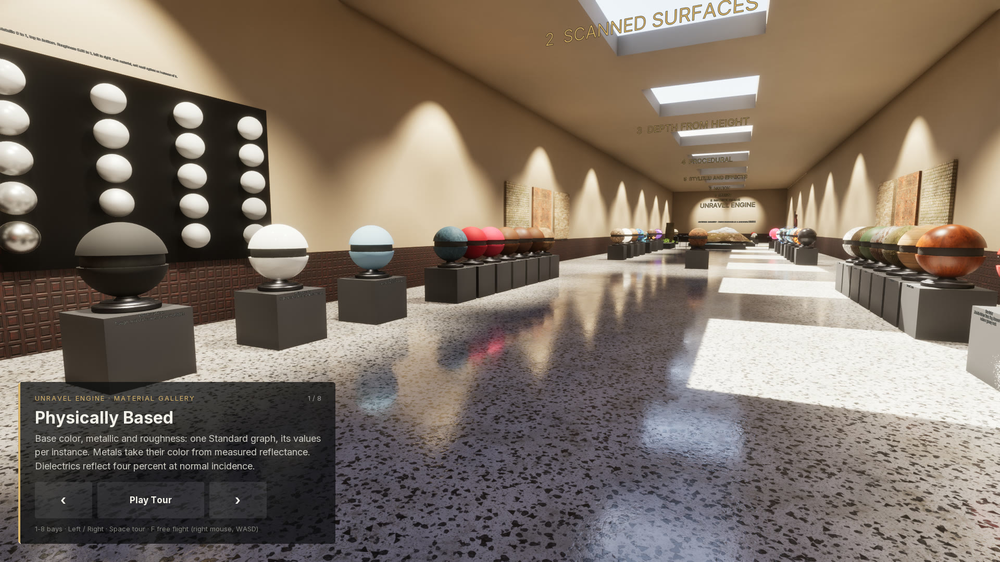
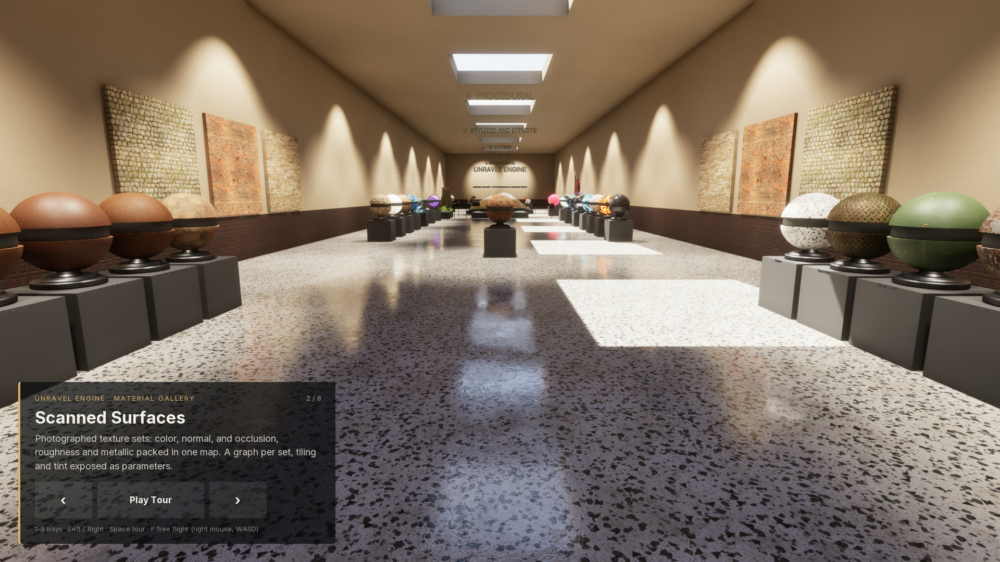
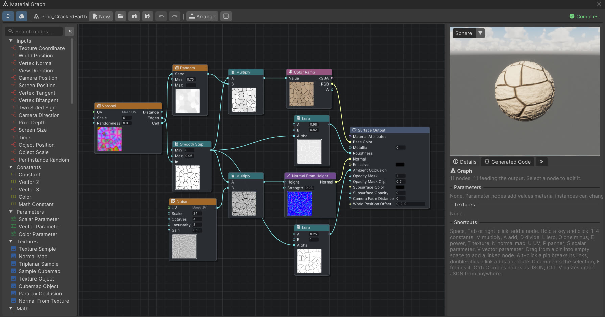

# Material Gallery

A gallery hall of eight bays that walks through what the engine's material graphs can do, from measured metals to
procedural lava. Every surface in the hall, the floor and walls included, is a material graph: open any `.mat` in
the Material Graph window (double-click it in the Content Browser) to see how it is built, change a value and watch
the scene follow. A sample project for [Unravel Engine](https://github.com/unravel-dev/UnravelEngine).

## Play

Clone this repository, or get it from the Samples page of the Unravel editor's start page, and open its folder in
the editor. Open `data/Scenes/Gallery.spfb` and press Play.

| Action | Keyboard and mouse | Gamepad | Touch |
|---|---|---|---|
| Go to a bay | 1 - 8 | - | - |
| The bay before or after | Left / Right | - | The HUD's arrows |
| Start or stop the tour | Space | - | Play Tour button |
| Free flight | F; hold the right mouse button to look, WASD to move, Q / E down and up, Shift to hurry, the wheel for speed | - | - |

## What it shows

1. **Physically Based.** Metals and dielectrics from the Standard graph with measured values. A 5 x 5 chart of
   metallic against roughness: one material, each sphere an instance that overrides Metallic and Roughness.
2. **Scanned Surfaces.** Photographed texture sets with packed occlusion, roughness and metallic maps, a detail
   normal blended with Blend Normals, and triplanar projection without UVs.
3. **Depth From Height.** Parallax Occlusion against the same maps as normal maps alone, and a single Bump Offset.
4. **Procedural.** Cracked earth, marble, wood, mosaic, carbon fibre, lava, terrazzo and caustics from noise,
   Voronoi cells, waves and Color Ramps, with no textures.
5. **Stylized and Effects.** Hologram, force field, dissolve, iridescent coating, toon shading and a cubemap mirror.
6. **Motion.** World Position Offset: ferns in the wind around their own pivots with a phase per copy (Object
   Position, Per Instance Random), a waving banner, water, a twisting column and a breathing blob. A Vertex
   Interpolator carries the banner's shading from its vertices to its pixels.
7. **Layers.** Material Attributes blend whole surfaces: a terrain of rock, grass, mud and snow by slope and height,
   moss on a boulder, puddles on cobblestones.
8. **Imported Assets.** glTF models with their own maps, imported as Standard graph materials.

Each graph's parameters show in the inspector and can be overridden per entity.

## Screenshots

| | |
|---|---|
|  |  |
|  |  |
|  |  |
|  |  |
|  | |

## Project layout

| Path | What it holds |
|---|---|
| `data/Scenes/Gallery.spfb` | The hall and its eight bays. |
| `data/Materials/` | Every material in the gallery. `Arch_*` are the hall, `PBR_*` the Physically Based bay, `Scanned_*`, `Depth_*`, `Proc_*`, `FX_*`, `Motion_*` and `Layer_*` the bays of those names. |
| `data/Scripts/GalleryTour.cs` | The camera tour and free flight. The stops are a text field on the Main Camera entity, one line per bay. |
| `data/Scripts/Turntable.cs` | Turns the exhibits on their stands. |
| `data/UI/gallery_hud.rhtml`, `gallery_hud.rcss` | The HUD. |

## Platforms

| Profile | Notes |
|---|---|
| Desktop | Windows or Linux, as the editor runs on; every material at High material quality. |
| Android | Graph materials cooked at Low material quality, so their Quality Switch nodes take the cheaper branch, and lighter lighting settings. |
| Web | The browser player, at Low material quality and with lighter lighting settings, as Android. |

Deploy from the editor's Deploy window with a profile from `profiles/`.

## Credits

Textures, HDRIs and models are CC0 from Poly Haven, ambientCG and the Khronos glTF sample assets; every one is listed
in [CREDITS.md](CREDITS.md). The hall, the shader ball, the banner, the water sheet, the column and the terrain are
meshes generated for this sample.

Code and all other content are under the MIT license in [LICENSE](LICENSE).
