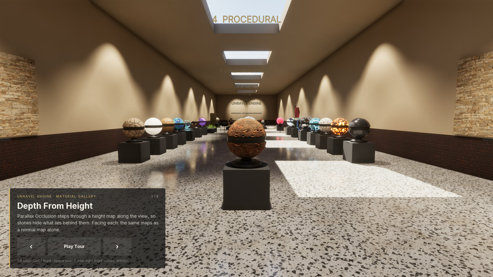
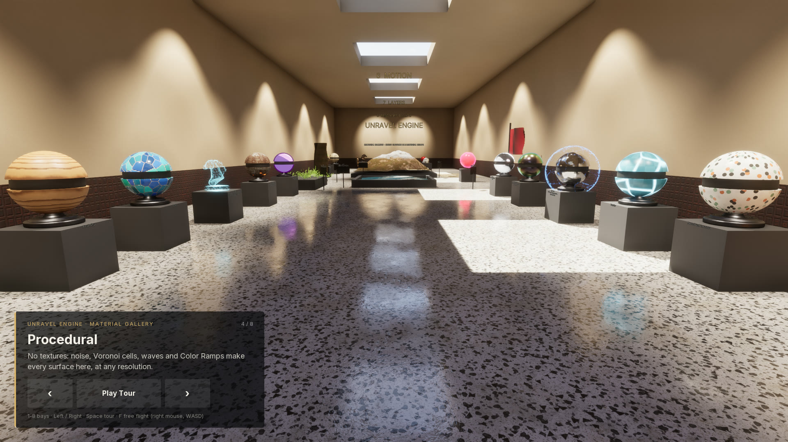
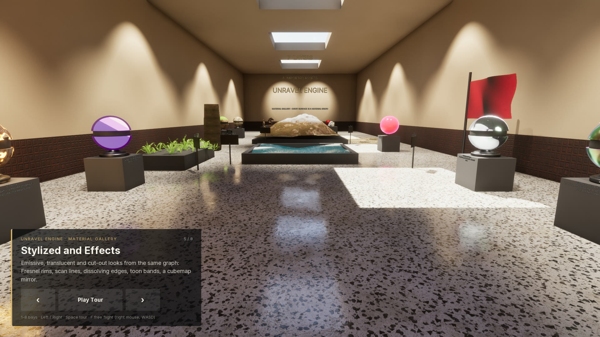
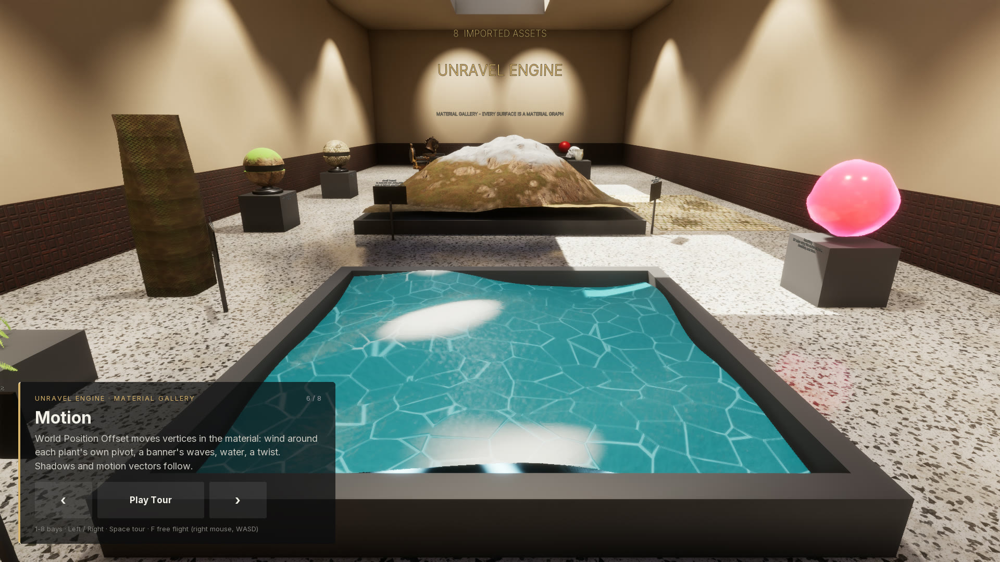

# Unravel Engine: Material Gallery

A walk through what Unravel's material graphs can do, from measured metals to procedural lava. Every surface in
the hall, the floor and walls included, is a material graph: open any `.mat` in the Material Graph window
(double-click it in the Content Browser) to see how it is built, change a value and watch the scene follow.

## Running it

Open the project in the Unravel editor, open `Scenes/Gallery` and press Play, or deploy it with the Desktop, Web
or Android profile.

| Key | Action |
| --- | --- |
| 1 - 8 | Go to a bay |
| Left / Right | The bay before or after |
| Space | Start or stop the tour |
| F | Free flight: hold the right mouse button to look, WASD to move, Q / E down and up, Shift to hurry, the wheel for speed |

On phones and in the browser the HUD's arrows and Play Tour button do the same.

## The bays

1. **Physically Based.** Metals and dielectrics from the Standard graph with measured values. A 5 x 5 chart of
   metallic against roughness: one material, each sphere an instance that overrides Metallic and Roughness.
2. **Scanned Surfaces.** Photographed texture sets with packed occlusion, roughness and metallic maps, a detail
   normal blended with Blend Normals, and triplanar projection without UVs.
3. **Depth From Height.** Parallax Occlusion against the same maps as normal maps alone, and a single Bump Offset.
4. **Procedural.** Cracked earth, marble, wood, mosaic, carbon fibre, lava, terrazzo and caustics from noise,
   Voronoi cells, waves and Color Ramps, with no textures.
5. **Stylized and Effects.** Hologram, force field, dissolve, iridescent coating, toon shading and a cubemap mirror.
6. **Motion.** World Position Offset: ferns in the wind around their own pivots with a phase per copy (Object
   Position, Per Instance Random), a waving banner, water, a twisting column and a breathing blob. A Vertex
   Interpolator carries the banner's shading from its vertices to its pixels.
7. **Layers.** Material Attributes blend whole surfaces: a terrain of rock, grass, mud and snow by slope and height,
   moss on a boulder, puddles on cobblestones.
8. **Imported Assets.** glTF models with their own maps, imported as Standard graph materials.

| | |
| --- | --- |
|  |  |
|  |  |
|  |  |
|  |  |

## Where to look

- `data/Materials/`: every material in the gallery. `Arch_*` are the hall, `PBR_*` the Physically Based bay,
  `Scanned_*`, `Depth_*`, `Proc_*`, `FX_*`, `Motion_*` and `Layer_*` the bays of those names. Each graph's
  parameters show in the inspector and can be overridden per entity.
- `data/Scripts/GalleryTour.cs`: the camera tour and free flight. The stops are a text field on the Main
  Camera entity, one line per bay.
- `data/UI/gallery_hud.rhtml` and `.rcss`: the HUD.

## Platforms

The Desktop profile draws everything at High material quality. The Web and Android profiles cook the graph
materials at Low Material Quality, so their Quality Switch nodes take the cheaper branch (the terrain's noise, for
one), and their lighting settings are lighter.

## Credits

Textures, HDRIs and models are CC0 from Poly Haven, ambientCG and the Khronos glTF sample assets: see
[CREDITS.md](CREDITS.md). The hall, the shader ball, the banner, the water sheet, the column and the terrain are
meshes generated for this sample.

The sample's own files are under the MIT license: see [LICENSE](LICENSE).
